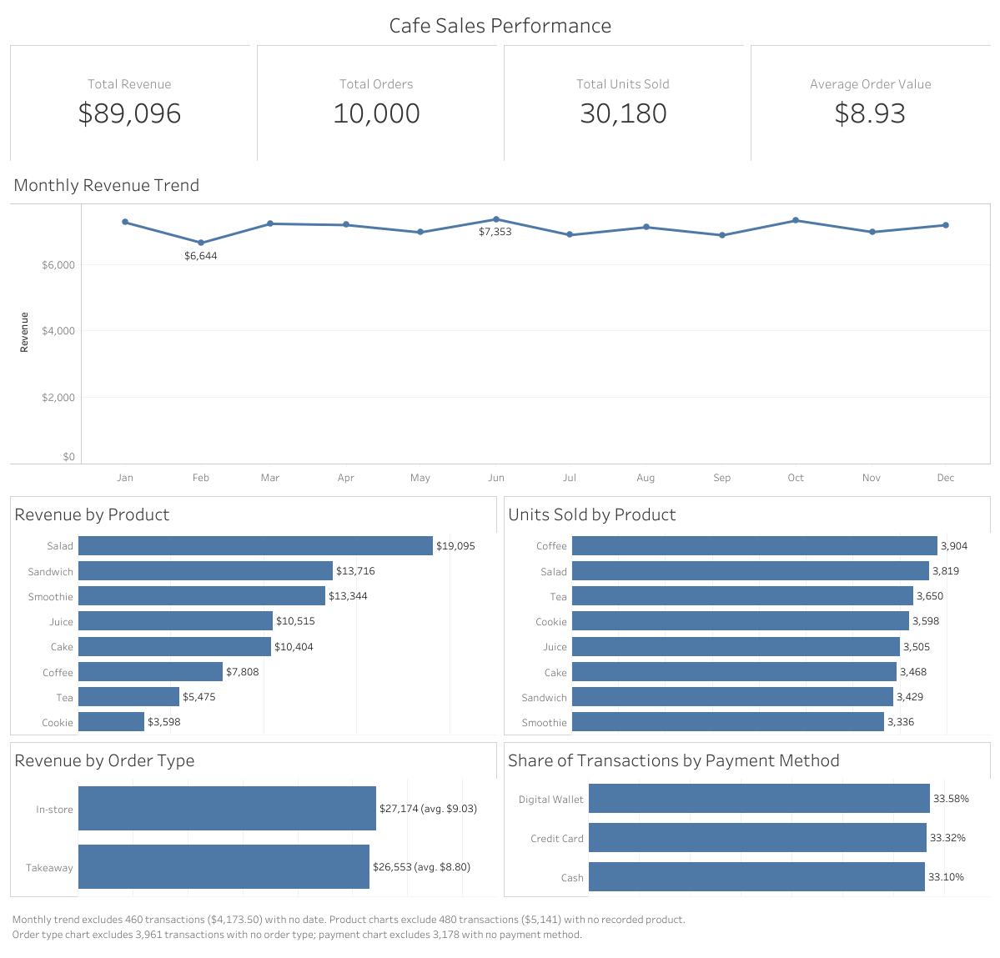

# Cafe Sales Analytics (SQL Server + Tableau)

I cleaned a messy cafe sales dataset in SQL Server, analyzed it with SQL, and built a Tableau dashboard to show sales performance, product performance, and monthly revenue trends.

**Tools:** SQL Server (T-SQL), SQL Server Management Studio, Tableau Public

**[View the dashboard on Tableau Public](TODO-add-link)**

## Dataset

- **Source:** [Cafe Sales - Dirty Data for Cleaning Training (Kaggle)](https://www.kaggle.com/datasets/ahmedmohamed2003/cafe-sales-dirty-data-for-cleaning-training)
- **Size:** 10,000 transactions from January–December 2023
- **Columns:** Transaction ID, Item, Quantity, Price Per Unit, Total Spent, Payment Method, Location, Transaction Date

Every column was stored as text, and every column except Transaction ID had blanks, `ERROR`, or `UNKNOWN` values. The worst were Location (3,961 invalid rows, ~40%) and Payment Method (3,178, ~32%).

## Data Cleaning

The SQL scripts in the `sql/` folder are numbered in the order they run.

**1. Staging table.** I copied the raw data into a staging table and did all cleaning there, so the original table stays unchanged.

**2. Duplicates.** All 10,000 transaction IDs were unique and present, so no rows were removed.

**3. Standardization.** I trimmed extra spaces and used `TRY_CAST` / `TRY_CONVERT` to find values that couldn't be converted to numbers or dates.

**4. Missing values.** I converted blanks, `ERROR`, and `UNKNOWN` to `NULL`, since all three mean the value is unknown. Then I recovered what I could from the same transaction:

- Each product always has the same price, and `total = quantity × price`. So when one of these values was missing, I could often calculate it from the others.
- I filled in missing product names from the price **only when the price belongs to one product** (e.g., $1.00 = Cookie). Cake and Juice both cost $3.00, and Sandwich and Smoothie both cost $4.00, so I left those as `NULL` instead of guessing.
- Payment method, order type, and date can't be calculated from other columns, so I left them as `NULL`.

| Column | Missing before | Missing after |
|---|---:|---:|
| item | 969 | 480 |
| quantity | 479 | 23 |
| price_per_unit | 533 | 6 |
| total_spent | 502 | 23 |

**5. Data types.** I converted the columns to `INT`, `DECIMAL(10,2)`, and `DATE`, and renamed `location` to `order_type`, because its values (In-store / Takeaway) describe the type of order.

**6. Validation.** The final table still has 10,000 rows and 10,000 unique IDs, and `quantity × price = total` for every complete row.

## Key Findings

- **$89,096** in recorded revenue, **30,180** units sold, and an average transaction of **$8.93**.
- **Monthly revenue was flat**, between $6,644 (February) and $7,353 (June), with no clear seasonal pattern.
- **Revenue follows price, not volume.** All products sold a similar number of units (3,336–3,904). Salad ($5.00) brought in the most revenue ($19,095), while Coffee sold the most units (3,904) but ranked 6th in revenue at $2.00.
- **Order type and payment method were almost evenly split.** In-store and Takeaway had nearly the same number of transactions and average value ($9.03 vs $8.80), and each payment method was about 33% of transactions.

The distributions are very even, and prices never change, so this dataset is likely synthetic. These findings show the analysis process rather than insights about a real cafe.

## Limitations

- **23 transactions have no total**, so total revenue is slightly understated.
- **460 transactions ($4,173.50) have no date.** They're included in total revenue but not in the monthly trend.
- **480 transactions ($5,141) have no product.** Most of them are Cake/Juice or Sandwich/Smoothie, so those four products are slightly undercounted.
- **Order type and payment method results only cover about 60% and 68% of transactions.**
